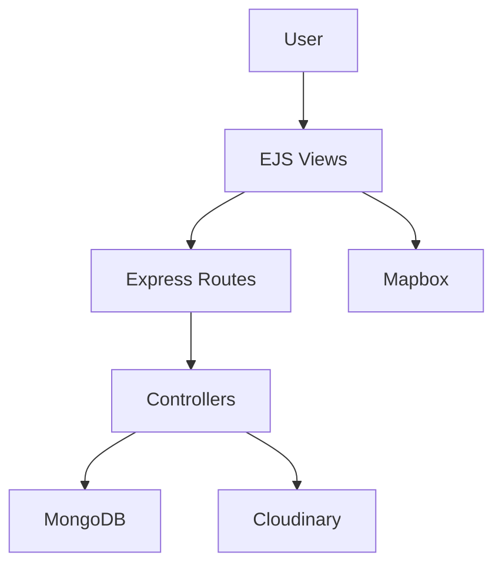

# Full Stack Web Application

A full-stack web application built using Node.js, Express.js, EJS, and MongoDB.

## 🚀 Features

- User Signup and Login
- Create, Edit, and Delete Listings
- Review and Rating System
- Authentication and Authorization
- Image Upload with Cloudinary
- MongoDB Database Integration
- Responsive UI with Bootstrap

## 🛠️ Tech Stack

- Frontend: HTML, CSS, Bootstrap, EJS
- Backend: Node.js, Express.js
- Database: MongoDB, Mongoose
- Authentication: Passport.js
- Validation: Joi
- Image Storage: Cloudinary
- Maps: Mapbox

## 🏗️ System Architecture

## ⚙️ Installation

1. Clone the repository:

   `git clone https://github.com/rohansohamdey-art/Full-stack-web-application.git`

2. Open the project folder:

   `cd Full-stack-web-application`

3. Install dependencies:

   `npm install`

4. Create a `.env` file and add the required credentials.

5. Start the application using the command configured in `package.json`.

## 🔐 Environment Variables

Configure your MongoDB connection string, session secret, Cloudinary credentials, and Mapbox token in `.env`.

**Never upload `.env` or secret credentials to GitHub.**

## 👨‍💻 Author

**Soham Dey**

GitHub: [rohansohamdey-art](https://github.com/rohansohamdey-art)
